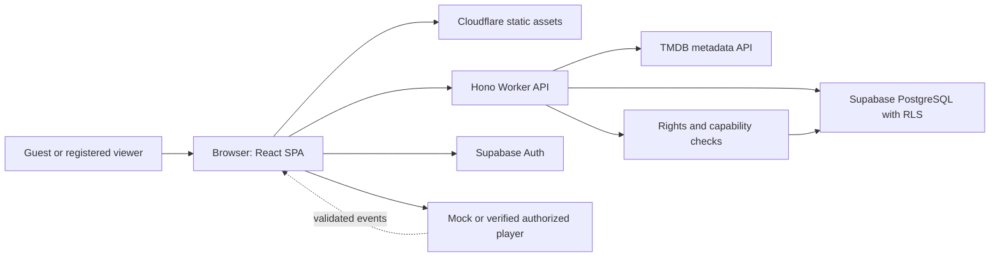
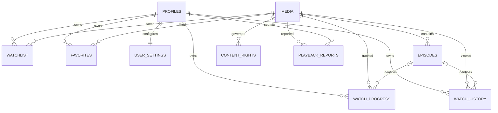
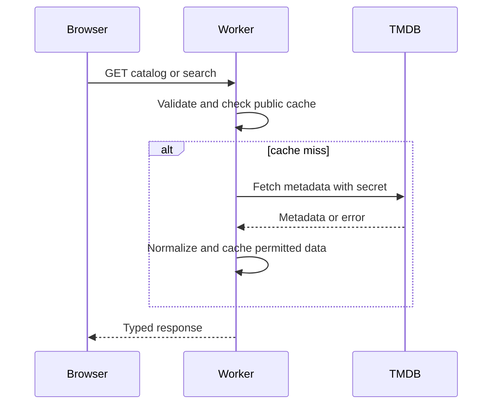
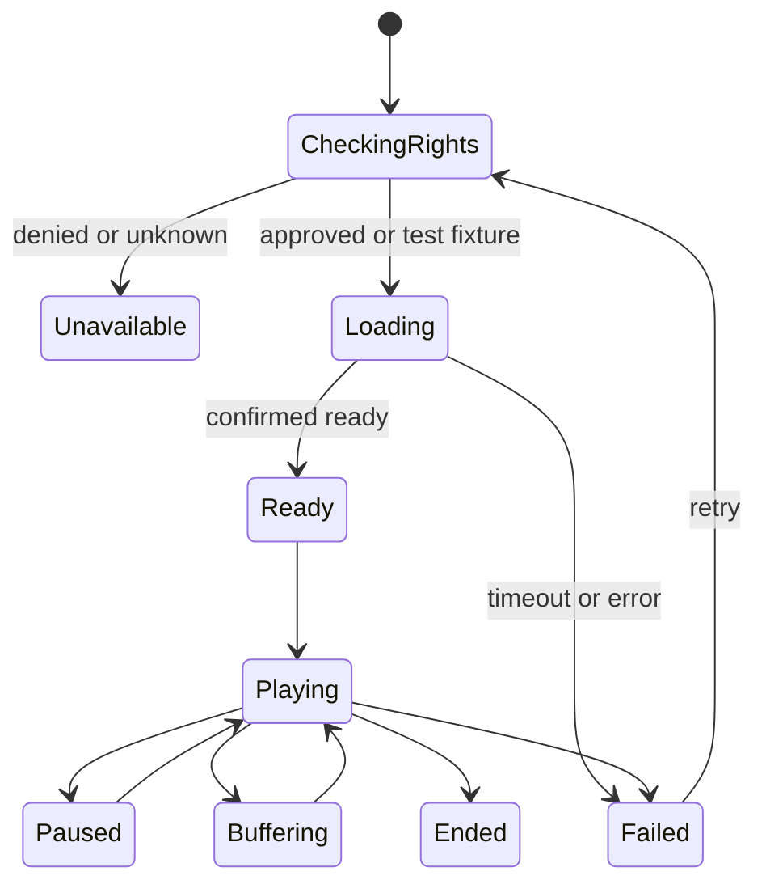
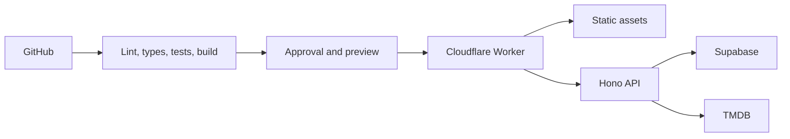

# Sinegang — Software Architecture Design Document
Version 6.0 | Proposed implementation baseline | Companion to PRD.md, AGENTS.md and DESIGN_SYSTEM.md

## 1. Purpose and architectural drivers
Sinegang is a cinematic movie/TV discovery and authorized viewing application. The PRD owns scope, AGENTS.md owns engineering policy, DESIGN_SYSTEM.md owns visual behavior, and this document owns technical boundaries and contracts. Security, accessibility, privacy and verified rights take precedence. This is a design, not a claim that the system has been implemented or tested.

Drivers: free-tier friendly operation, static-first delivery, motion-rich client UI, typed interfaces, account isolation, provider replaceability, minimal operational complexity and graceful degradation. No video proxy, transcoding, microservices, Redis or dedicated VM in MVP.

## 2. Architecture decisions
| ADR | Decision | Rationale / trade-off |
|---|---|---|
| 001 | React + Vite SPA | Static CDN delivery; dynamic title SEO is limited; consider prerendering public landing |
| 002 | Single Cloudflare Worker with static assets and Hono | Same-origin API and one deployment; constrained CPU and runtime compatibility |
| 003 | Supabase Auth + PostgreSQL | Managed identity and relational constraints; enforce RLS even when API validates tokens |
| 004 | TMDB through Worker | Protect credentials, normalize metadata, cache public responses |
| 005 | Replaceable playback adapter | Mock by default; BingeAPI is a candidate only until authorization and security review |
| 006 | TanStack Query + Router | Remote state and URL filters; Zustand only for ephemeral shared UI |
| 007 | Motion for React | Client-side visual choreography, reduced-motion alternatives; no duplicate animation engine |

## 3. System context and containers

Trust boundaries: browser is untrusted; Worker holds secrets and validates requests; Supabase enforces row ownership; external metadata and playback are untrusted inputs. Media bytes never pass through the Worker. Browser playback is permitted only after a server-side rights decision. Discovery remains available if playback is disabled.

## 4. Logical components
| Component | Responsibilities |
|---|---|
| App shell | Router, query provider, error boundary, auth state, navigation |
| Landing | Static-first editorial sections, Motion primitives, accessible CTA |
| Catalog | Rails, filters, search, pagination, details, seasons |
| Library | Watchlist, favorites, history, settings, progress |
| Playback | Capability-aware UI, lifecycle, mock adapter, verified provider boundary |
| Hono middleware | Request IDs, validation, auth, safe errors, rate limiting |
| Metadata service | TMDB requests, response normalization, public caching |
| Library service | User-scoped database operations and idempotency |
| Rights service | Authorization, territory, age eligibility, validity and provider policy |
| Admin service | Restricted rights review, reports and audit records |

## 5. Repository layout
```text
src/
  routes/            TanStack Router route definitions
  components/        ui, landing, media, motion
  features/          catalog, auth, library, playback
  lib/               query keys, browser Supabase client
  styles/            semantic design tokens
worker/
  index.ts           Hono entrypoint
  routes/            metadata, library, playback, admin
  middleware/        auth, validation, errors, rate limits
  services/          metadata, cache, library, rights
shared/              Zod contracts and TypeScript types
supabase/migrations/ schema, policies, indexes
tests/               unit, integration, E2E
vite.config.ts
wrangler.jsonc
```
Dependencies flow from routes to feature/service modules to adapters. Shared contracts must not import browser or Worker-specific modules. Do not import server secrets into frontend code. Use pnpm and commit the lockfile.

## 6. API design
All routes are same-origin `/api/*`; JSON success responses contain data and optional pagination; errors contain code, safe message and requestId. Validate request and upstream schemas with Zod. IDs are positive integers; TV season/episode validation depends on metadata and provider capability. Bound page sizes and query lengths.

| Method and path | Access | Responsibility |
|---|---|---|
| GET /api/movies, /api/tv, /api/trending | Public | Catalog rails |
| GET /api/search, /api/discover | Public | Search and filters |
| GET /api/movies/:id, /api/tv/:id | Public | Details |
| GET /api/tv/:id/seasons | Public | Seasons and episode metadata |
| GET /api/recommendations | Optional auth | Popularity or consented personalization |
| GET, POST /api/watchlist | Auth | List and idempotent save |
| DELETE /api/watchlist/:id | Auth | Remove own item |
| GET /api/history | Auth | Own viewing history |
| DELETE /api/history/:id | Auth | Remove own history item |
| PATCH /api/progress | Auth | Validate and persist supported progress |
| POST /api/playback/report | Auth | Report issue without sensitive payloads |
| DELETE /api/account | Auth + recent verification | Account deletion workflow |
| POST /api/playback/session | Eligibility checked | Proposed internal rights-gated playback contract |

Additional favorites, settings and admin routes require explicit contracts before implementation. Use 400/401/403/404/409/429/502/503 as appropriate. Never return SPA HTML for API failures. Public metadata may be cached; private responses use no-store.

## 7. Data architecture

Profiles reference auth.users UUID. Media has unique (media_type, tmdb_id); episodes unique (media_id, season_number, episode_number). Watchlist and favorites unique (user_id, media_id). Progress uses separate partial unique indexes for movies and episodes, nonnegative position and positive known duration, with position bounded by duration. Ensure episode belongs to media using a composite foreign key or equivalent constraint. UTC timestamps; server-generated update timestamps and version for concurrency. History records only confirmed playback; deduplicate repeated session events. Content rights records contain provider, territory, authorization status and validity dates; episode-level coverage must be explicit where applicable. Index user/date queries and rights lookups. Keep reports minimal and add admin audit records via migrations. Use explicit cascading deletion for personal records; document any lawful retention exceptions.

RLS: enable on all exposed tables; user-owned rows require auth.uid() = user_id (profiles use id). Public metadata is read-only where exposed. Rights writes and admin access require server-verified roles; no user-controlled role metadata. Service-role keys never reach browser; ordinary operations use user-scoped tokens. Test anonymous, owner, other user and admin cases.

## 8. Runtime flows
### Discovery

Debounce search around 300 ms, cancel stale requests, use query keys including filters and locale. Cache TTLs are configurable and subject to upstream terms; start with short trending TTL and longer stable details TTL. Bound retries to transient failures and respect Retry-After.

`GET /api/title/:kind/:id` returns a validated, reduced TMDB detail record. Catalog and search cards carry the TMDB media ID into this route and then into `/api/playback/resolve`; the resolver builds the fixed-origin BingeAPI movie or episode URL using that same ID. TV detail data supplies numbered seasons and episode counts for the Sinegang season/episode selector. The BingeAPI player remains the authority for actual playback availability.

### Authentication and library
Browser signs in through Supabase Auth; OAuth uses PKCE and approved redirects. Worker validates bearer token signature, issuer, audience and expiry using supported Supabase verification; derive user identity from verified claims. Use RLS-scoped database access. On logout clear private query caches. Optimistic watchlist updates must roll back on failure. Never cache authenticated responses at the edge.

### Playback and synchronization

The supplied BingeAPI reference describes iframe delivery, browser-local resume and cross-window events/commands; it does not establish distribution authorization or independently verified security. No production integration until rights, territories, privacy, age controls and iframe security are reviewed. Use owned or public-domain media in the mock adapter. Unsupported capabilities remain hidden. The provider interface returns unavailable or a rights-approved session with explicit capabilities. Use approved origin allowlists, exact message target origins, source-window checks and schema validation. Do not assume episode identity events exist; disable cross-episode synchronization if identity is ambiguous. Do not bypass restrictions or proxy video. If rights cannot be verified, show official viewing alternatives.

For supported progress, accept only validated events associated with the active playable item; throttle writes (initial target 30 seconds), save on pause/end and best-effort on navigation. Avoid relying on unload delivery. Use optimistic concurrency versions to reject stale writes; reconcile on conflict. Resume only from confirmed saved position, and avoid conflicting native resume. Completion threshold is a product decision; do not infer completion from loading. Never write progress for an unconfirmed player state.

## 9. Deployment and configuration

Use Cloudflare Vite plugin and Wrangler with one Worker deployment. Configure SPA fallback for non-API navigation and Worker-first routing for `/api/*`; verify exact config against installed tool versions. Local development uses Worker runtime emulation. In environments where the local Workerd runtime cannot use the outbound HTTP proxy, `vite.tmdb-local-proxy.ts` invokes the same Hono app in Node for TMDB discovery and search routes only; `scripts/dev.mjs` enables Node's environment proxy support. This bridge is development-only; production requests execute in the Cloudflare Worker. Use separate local/preview/production environments and Supabase projects where practical. Apply reviewed migrations before compatible code deployment; prefer additive migrations and rollback-compatible changes. Never auto-enable paid services or deploy publicly without approval.

| Variable | Location |
|---|---|
| TMDB_API_TOKEN | Worker secret |
| VITE_SUPABASE_URL | Public build config |
| VITE_SUPABASE_PUBLISHABLE_KEY | Public build config |
| SUPABASE_SERVICE_ROLE_KEY | Worker secret only if essential |
| PLAYBACK_PROVIDER | Worker config; default mock |

Keep local secrets in ignored .dev.vars or local environment files; commit placeholders only. Configure OAuth redirects and HTTPS. Verify deep links, API routing, secret exposure and actual Worker usage. Check current free-tier quotas and terms before release; licensing and excess usage are separate costs.

## 10. Security, privacy and abuse controls
Threats and mitigations: forged identity -> verified tokens and RLS; IDOR -> ownership tests; XSS -> escaped content and CSP; malicious iframe -> approved origins and security review; SSRF -> fixed upstream hosts and no arbitrary proxy URLs; abuse -> bounded requests and rate limits; cross-user cache leaks -> no-store for private data; leaked credentials -> secret bindings and scanning; unauthorized playback -> fail-closed rights checks; sensitive history exposure -> minimal logging and deletion controls. Review applicable Philippine privacy and copyright requirements. Age-appropriate discovery and playback are mandatory; unknown eligibility fails closed for restricted playback. Cookie-based mutations, if introduced, require CSRF controls. Do not treat an iframe as a trusted security boundary without review.

## 11. Performance and reliability
Static assets should bypass Worker computation where possible. Lazy-load routes and player, size artwork appropriately, reserve image geometry, avoid unnecessary polling, and use transform/opacity animations with reduced-motion alternatives. Target LCP <= 2.5 s, INP <= 200 ms, CLS <= 0.1 and cached API responses under 500 ms; measure on representative mobile devices and networks. Monitor Worker CPU, requests, cache hit ratio, upstream errors and database writes. Use request IDs and sanitized structured logs; never log tokens or unnecessary viewing data. If TMDB fails, show permitted cached metadata or retry UI; if Supabase fails, keep guest discovery available; if playback fails, preserve confirmed progress and offer authorized alternatives.

## 12. Testing and release gates
| Layer | Tests |
|---|---|
| Unit | Zod schemas, cache keys, rights decisions, progress concurrency, motion preferences |
| Integration | Hono runtime, TMDB fixtures, token validation, RLS and migrations |
| E2E | Landing, discovery, search, details, auth, library, mock playback, deep links |
| Security | Cross-user access, invalid messages, expired rights, secret scanning, rate limits |
| Accessibility | Keyboard, focus, contrast, reduced motion, mobile layout |
| Deployment | Production build, preview smoke tests, Worker limits, rollback plan |

Release requires recorded test results, no critical security findings, and approval. Discovery-only release is valid when external playback remains unverified. No fabricated test results.

## 13. Implementation order and traceability
1. Foundation: Vite/Worker routing, tokens and motion primitives (FR-01).
2. Metadata service and catalog (FR-02–06).
3. Auth, schema, RLS, library and settings (FR-08–11).
4. Mock playback, progress and reporting (FR-07, FR-09, FR-13).
5. Recommendations and optional capabilities (FR-12).
6. Provider review, performance, accessibility, security and deployment gates.

## 14. Open decisions
Confirm provider rights and security, TMDB usage terms, current free-tier limits, age eligibility policy, retention periods, completion threshold, admin role provisioning and public SEO strategy. Record decisions as ADRs; do not silently substitute providers or introduce paid infrastructure.


## V6 approved creative direction
IMPLEMENTATION_PLAYBOOK.md governs the approved UI/UX decisions and clarification workflow. Use minimal Apple-style storytelling (original design), scroll-driven hero, floating minimal navigation, immersive experimental motion, shared layout movie-card transitions, hybrid rails/grid, oversized expressive typography, and system-preference light/dark themes. These supersede conflicting earlier visual defaults. Preserve brand palette and architecture. Do not ask the user to reconfirm these choices.

## Community data boundary addendum
Add `user_ratings`, `user_reviews`, `community_rating_stats`, `review_reports`, `user_blocks`, and `moderation_actions`. A user has at most one rating for each `(media_type, tmdb_id)` key. Private rows use owner-only RLS. Public rating aggregates derive solely from explicitly shared rows and are recomputed on create, edit, delete and withdrawal. Public review APIs must emit only approved fields and exclude unapproved, withdrawn, blocked or age-ineligible content. Admin actions require a server-verified role and audit trail. No public review endpoint is enabled until reporting, blocking, moderation and age policy are verified end to end. Community discovery must use eligible aggregates, not private user data.

## Approved glass and discovery experience
Glassmorphism is now an approved required design direction and supersedes earlier restrictions in the V6 documents. The React client owns a reusable multi-level glass material system and component primitives specified in `DESIGN_SYSTEM.md`; these are presentation components only and do not alter API trust boundaries. Use dark smoked and light frosted pearl variants, semantic CSS variables, solid fallbacks, and limited placements. Do not animate backdrop filters, stack full-screen filters, or blur every poster. Validate contrast on variable artwork and reduced-motion/transparency fallbacks.

Discovery modules include featured cinematic hero, Top 10 movies and series, trending, community favorites, theatrical releases, popular TV, critically acclaimed, coming soon, genres, continue watching, data-sufficient personalized recommendations, highest-rated Sinegang titles, and eligible privacy-safe community activity. Source each module from real catalog/API data, label TMDB signals separately from Sinegang aggregates, and return explicit insufficient/unavailable states rather than fabricated metrics. Keep personalization off when there is insufficient consented data. Preserve guest-first discovery and playback. Watch UI may offer theater mode, season/episode navigation, progress sync, subtitles and controls only when a verified provider contract supports them.

The glass, responsive navigation, featured-title hero, poster, detail, player, search, Community tab, profile and light-theme compositions were resolved on 2026-11-24 and are recorded in `docs/DECISIONS.md`. cno.to reference priority remains tracked as open in `docs/OPEN_QUESTIONS.md`. Architecture, privacy, rights and accessibility constraints remain in force.

## Selected playback source update
The project owner selected BingeAPI and supplied an iframe/postMessage technical reference on 2026-11-24. It remains an inactive provider candidate until written content rights, territories, privacy terms and iframe security are verified. `docs/PROVIDER_REVIEW.md` records the known technical contract and release blockers. The mock provider remains active. No client may construct a live embed or infer title availability from a TMDB ID alone.


## Supplementary reference-audit architecture scope
The cno.to audit adds product surfaces, not a reason to change the approved React/Vite/TypeScript, Hono/Workers, Supabase, TMDB, and Motion architecture. Planned additions include public TMDB person/credits data, genre-filtered catalog routes, complete episode metadata, and related-title data. Define bounded and validated TMDB service routes before implementation; keep credentials server-side and public responses reduced. Do not infer private provider APIs or reuse a third-party playback mechanism. Current route/data status is tracked in `docs/FEATURE_MATRIX.md` and `docs/SCREEN_SPECIFICATIONS.md`.


## Owner update — runtime provider selection (2026-11-25)
The owner selected BingeAPI direct iframe playback and requested no mock playback. The current production Wrangler configuration selects BingeAPI with the documented hosting welcome option. The resolver returns pending because it cannot inspect title availability; only the browser player can confirm playback. Keep the unavailable message as the only fallback. Do not infer full-catalog or territory coverage from TMDB IDs or HTTP 200 pages. A production-style local build was tested; no public deployment was made and a browser `play` event was not confirmed.
